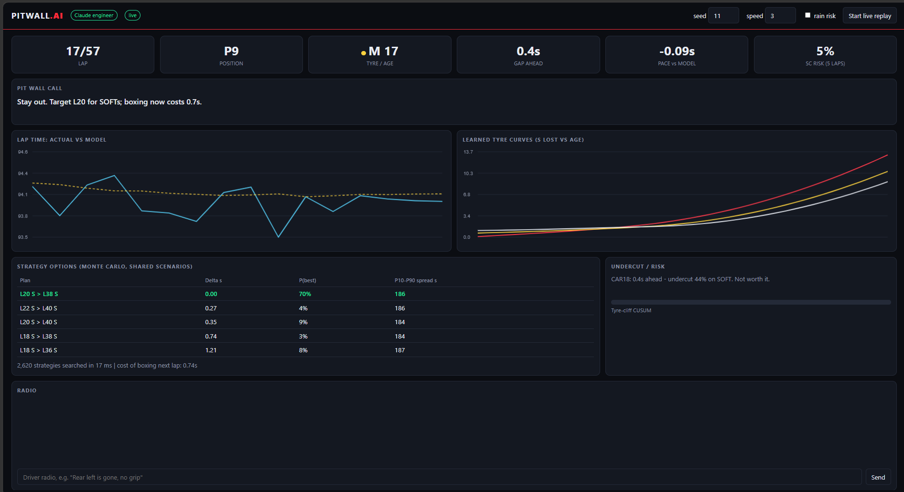

# PitWall AI

[](https://github.com/AnandRddy/pitwall-ai/actions/workflows/ci.yml)

**A real-time race-strategy engine for Formula 1 pit walls**: it learns tyre behaviour live, simulates thousands of race futures per lap, and tells the strategist *box or stay out*, with the probability and the cost of being wrong. A tool-using LLM race engineer turns those numbers into radio calls.



```
 practice laps ─┐                       ┌─► Monte Carlo strategy search ─┐
 live lap data ─┼─► Tyre-deg model ─────┤   (8,000+ strategies / lap)    ├─► BOX / STAY OUT
 timing gaps  ──┤   (ridge, per-compound│                                │   + P(best), cost of
 radio text   ──┤    curves, refit/lap) ├─► Undercut evaluator           │   boxing now
                │                       │                                │
                ├─► CUSUM cliff alarm ──┘   Safety-car hazard model ─────┘
                │                           (logistic, learned)
                └─► Claude race engineer (tool use) ──► radio call ──► live dashboard
```

## Why this is a real pit-wall problem

Strategy calls are made under uncertainty with seconds to decide: tyres degrade non-linearly, a safety car can erase a pit stop's cost, and rivals react. PitWall AI treats it as what it is, a decision problem under uncertainty, not a lap-time regression.

| Capability | How it works |
|---|---|
| **Tyre degradation learning** | Joint ridge regression: driver pace + per-compound cubic age curves + fuel effect. Curves forced monotone; unseen ages get a convex, risk-averse extrapolation. Refit every lap on all cars' clean laps. |
| **Strategy optimisation** | Stage 1 ranks every legal strategy (≤3 stops, two-compound rule, min stint) with a closed-form cost from cumulative tyre curves. Stage 2 runs a diverse shortlist through a vectorised Monte Carlo with shared random scenarios (safety cars, stop-time variance, slow stops, lap noise), then locally refines the leaders. |
| **Safety-car hazard model** | Logistic regression learns P(SC deploys) from race context (opening laps, rain, cool-down). Feeds the Monte Carlo and a "SC risk next 5 laps" gauge. Pit loss is discounted when the SC is out, so the engine says *BOX* when it should. |
| **Undercut / overcut** | Monte Carlo over the rival's reaction lag, stop variance and rejoin traffic: P(we emerge ahead). |
| **Tyre-cliff detection** | CUSUM on model residuals flags sustained pace loss within ~3 laps; also nudged by parsed driver radio ("rear left is gone"). |
| **LLM race engineer** | Claude tool-use loop over 5 tools (state, optimise, undercut, SC outlook, tyre status). Invoked only on events (box call, SC, cliff alarm, driver radio) to bound cost and latency; every number must come from a tool. Falls back to a deterministic engineer offline. |
| **Live dashboard** | FastAPI WebSocket feed: lap-time vs model, learned tyre curves, strategy table with P(best), undercut odds, radio log, driver radio input. |

## Run it

```bash
pip install -e ".[dev]"
pytest -q                                   # 20 tests (offline)
python -m pitwall.api.server                # dashboard at http://127.0.0.1:8000
python -m pitwall.evaluation.backtest --races 200 --seed 42       # simulator backtest
python -m pitwall.evaluation.real_data --years 2023 2024          # real-race validation (downloads once, cached)
```

Optional: `pip install -e ".[llm]"` and set `ANTHROPIC_API_KEY` for the Claude engineer; Real races load from the open OpenF1 API (`pitwall.data.openf1_loader.load_race(2024, "Bahrain")`, no key needed); a FastF1 loader is also included but FastF1 now requires a Formula 1 account. Docker: `docker build -t pitwall . && docker run -p 8000:8000 pitwall`.

## Live on real races

The dashboard can replay any 2023-24 race from the open OpenF1 API, lap by lap, as if the data were arriving live:

- **Pick a race, year and driver**, and optionally a **start lap** to fast-forward (handy for lining up with a video). The model starts knowing only *earlier* races, then learns each lap as it arrives, so there is no look-ahead except the "safety car deployed" notice a real pit wall receives.
- **GPS race replay**: all 20 cars animated around the real circuit from OpenF1 position data (your car in red, the leader in gold), in step with the strategy feed.
- **Race video panel**: paste a YouTube link (e.g. highlights) to watch alongside. The official broadcast is copyrighted, so it is embedded from a link you supply, not downloaded; it is not lap-synced.
- **Raw-data explorer**: [`docs/real_race.html`](docs/real_race.html) shows one real race's tyre stints, lap times and the exact rows the models receive (regenerate any race with `python scripts/real_data_view.py 2024 Monaco docs/monaco.html`).

First load of a race downloads and caches its laps and GPS (about a minute); after that it starts instantly.

## Results

### A. Validated on real races (OpenF1, 2023-24)

46 races loaded; 36 usable after excluding red-flag and wet races. No account or key needed
(`python -m pitwall.evaluation.real_data`, full output in [`reports/real_data.json`](reports/real_data.json)).

| Question | Result |
|---|---|
| **Tyre model:** forecast the next 10 laps (rolling origin at laps 15 / 25 / 35; 22 races, 16,353 laps) | Mean abs error **0.505 s** vs **0.651 s** for a "recent pace + fuel" engineer heuristic (**22% better**; 20% / 21% / 27% at the three origins) |
| ...ablation: same model without historical races | 0.691 s, *worse* than the heuristic (0.891 s at lap 15). Pooling prior races as the team's history database is what makes it work |
| **Safety-car hazard:** leave-one-race-out over 39 races | Log-loss 0.0500 vs 0.0540 for a constant rate (7% better); mean predicted P(at least one SC) 41.8% vs 41.0% observed. A modest gain; 16 races had a safety car |
| **Pit stop cost** (1,063 green stops) | Median **22.7 s** lost to the field |
| **Pit stop under safety car** (100 stops, VSC excluded) | **15.3 s = 0.67x** a green stop (90% CI 0.56-0.74), not the 0.45 I first assumed |

What the real data changed:
- The first version of the tyre model **lost to the baseline** (0.92 s vs 0.66 s). Causes: tyre age is nearly collinear with fuel burn in the opening laps, and ten laps per driver is too little data. Fixes: fuel effect shrunk to a physical prior, historical races pooled at lower weight, per-driver recent-pace correction.
- My first pit-loss measurement was wrong (it compared slow safety-car laps to green-flag pace). It is now measured relative to the field on the same laps.
- The simulator's safety-car pit discount was optimistic (0.45 vs 0.67 measured). The simulator is now calibrated to the measured values, which **reduced** the backtest gains below.

Exploratory (not evidence of gains): in a shadow replay at lap 18 over 516 real driver plans, PitWall's own model puts the median real plan 6.8 s from its optimum and only 12% within 1 s. That gap is estimated by the model, and has no relationship to real places gained (Spearman 0.04). **No claim is made that PitWall would have gained time in real races.**

### B. Closed-loop backtest on the calibrated simulator (200 races, seed 42)

All policies drive the *same* car through the *same* hidden reality (true tyre physics, safety-car laps, lap noise, stop variance). The AI only sees noisy practice data (which never reaches the tyre cliff) plus the laps it has driven.

| Race type | Adaptive AI vs static pre-race optimum | Adaptive AI vs conventional M>H template |
|---|---|---|
| All races (n=200) | **+0.62 s** (wins 62%) | **+0.40 s** (wins 64%) |
| With safety car (n=90) | **+1.26 s** (wins 67%) | +0.56 s (wins 52%) |
| No safety car (n=110) | +0.09 s (wins 57%) | +0.26 s (wins 73%) |

These are small gains, honestly reported. An earlier run with the uncalibrated safety-car discount showed +2.2 s in safety-car races; real data showed that was inflated. Results also depend on the prior for tyre ages never observed (`extrap_penalty`): a less cautious value made the pre-race plan *worse* than the template (`-4.4 s`), so the conservative setting is used.

## Limitations (read before citing numbers)

- **Real data validates the models, not the race-time gain.** Part A tests forecasting, hazard and cost estimates on real races; the strategy-gain backtest (B) still runs on a simulator. A counterfactual on real races is not possible without a rival-reaction model.
- OpenF1 does not publish fuel or gaps: fuel is a linear burn estimate and positions/gaps are rebuilt from lap times.
- Single-car optimisation: rivals only appear in the undercut module. No traffic or dirty-air model in the main search.
- Tyre age does not advance behind the safety car; no inters/wets (wet races excluded); VSC stops excluded; SC length assumed 3-5 laps.
- Only 2023-24 (36 usable races); the safety-car signal in particular is small-sample.
- The Claude engineer has been run live against the dashboard manually (see screenshot), but not in CI since it needs an API key; the tool layer it calls is covered by tests.

## Roadmap

1. Per-circuit priors (tyre degradation, SC hazard) and a real-race counterfactual with a rival-reaction model.
2. Multi-car game-theoretic simulation (rival strategy inference, traffic, DRS trains).
3. Learned tyre model with uncertainty (hierarchical Bayesian / GP) instead of ridge polynomials.
4. Weather nowcasting inputs for the rain/inters decision.

## Layout

```
src/pitwall/
  physics.py            hidden-truth tyre/fuel/SC physics (simulator + backtest only)
  data/                 Race/LapTable schema, simulator, FastF1 loader
  models/               tyre_deg.py (ridge curves), safety_car.py (logistic hazard)
  strategy/             monte_carlo.py, optimizer.py, undercut.py, anomaly.py (CUSUM), brain.py
  agent/                engineer.py (tools + Claude loop + rule fallback), radio.py
  pipeline.py           lap-by-lap shadow-mode replay session
  api/                  FastAPI + WebSocket + dashboard
  evaluation/backtest.py  closed-loop policy comparison
tests/                  models, strategy, system (API, WebSocket, backtest)
```
